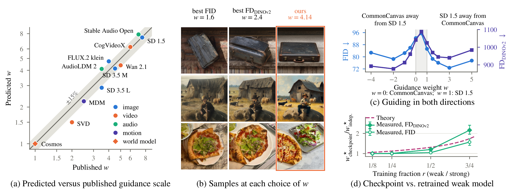

<h1 align="center">Guidance as Variance Matching</h1>

<p align="center">
  <b>Official implementation of the paper "Guidance as Variance Matching"</b>
</p>

<p align="center">
  <a href="https://ottogin.github.io/vmg/">Project page</a> &nbsp;·&nbsp;
  <a href="#compute_wpy-the-weight-of-a-guided-pair">Quick start</a> &nbsp;·&nbsp;
  <a href="reproduce/README.md">Reproduce the paper</a> &nbsp;·&nbsp;
  <a href="samples/README.md">Samples</a>
</p>

<p align="center">
  
  
</p>

<p align="center">
  
</p>

<p align="center"><sub>
  (a) The variance-matched scale recovers the published scales of eleven models across image, video, audio, motion
  and world generation (Spearman &rho; = 0.96). (b) SD 3.5 Medium at the FID-optimal, FD<sub>DINOv2</sub>-optimal and
  our scale. (c) Guidance works in both directions. (d) A model guided by its own earlier checkpoint needs a larger
  scale than one guided by a retrained model.
</sub></p>

---

Code for the paper's rule for choosing the guidance weight of a diffusion model without sampling. It matches the
spread of the guided prediction over forward-noised calibration examples to the spread of the data.

The guided prediction is `D_w = D0 + w (D1 - D0)`, with D1 the primary prediction (conditional, or the strong
model) and D0 the reference (unconditional, or the weak model). At each noise level of the sampler,
`compute_w.py` picks `w` so that `tr Cov(D_w) = tr Cov(x0)` over the calibration inputs. It evaluates the two
networks once per input and level; nothing is sampled.

## Install

```bash
pip install -e .                      # the method: numpy, scipy, torch
pip install -e .[models,figures,dev]  # + the released pipelines (diffusers), matplotlib, pytest
```

## `compute_w.py`: the weight of a guided pair

```bash
python compute_w.py --model toy                       # a 2-D example with exact denoisers, seconds on a laptop

# CFG with one network, D0 = the empty prompt (any checkpoint of a supported diffusers pipeline family)
python compute_w.py --guidance cfg --model stabilityai/stable-diffusion-3.5-medium --dataset coco

# CFG with two networks: a class-conditional model and a separately trained unconditional one (EDM2)
python compute_w.py --guidance cfg-pair --model cond.pkl --reference uncond.pkl --dataset imagenet64

# autoguidance: a model guided by a weaker version of itself (EDM2 post-hoc reconstructions by name, or paths/URLs)
python compute_w.py --guidance autoguidance --model edm2-img64-s-1073741-0.045 \
    --reference edm2-img64-xs-0134217-0.110 --dataset imagenet64

# the paper's models are presets
python compute_w.py --model sd35m --n all
```

Every option has a default; with none given, the fit is the paper's: trace match, per-step schedule, 1,024
examples (and the mean pool whenever a constant is asked for).

| option | default | other values | |
|---|---|---|---|
| `--guidance` | `auto` | `cfg` · `cfg-pair` · `autoguidance` | how D0 is made; `auto` takes a preset's own pair, `cfg` (the empty prompt) without `--reference`, and with one `cfg-pair` if the reference is unconditional, else `autoguidance` |
| `--match` | `trace` | `cov` · `diag` · `all` | match the total variance (the paper's rule); the channel covariance matrix in Frobenius norm (App. D.1); or every coordinate's variance by least squares. `all` collects the sums of all three |
| `--mode` | `schedule` | `global` | one weight per sampler step, w(t) (eq. wstar), or one constant |
| `--pool` | `mean` | `l1` · `l2` | how a constant pools the steps (App. D.2): the step-averaged residual vanishes (eq. wconstant), or the mean absolute or squared residual is smallest |
| `--n` | `1024` | any N · `all` | calibration examples (the first N; App. D.3: about 250 already give the weight to ±3%) |
| `--dataset` | the model's first | another it lists · `folder:<dir>` | calibration data; a folder holds images and `index.jsonl` lines `{"file", "caption"}` or `{"file", "label"}` |
| `--datamean` | off (the covariance) | | the second moment about the data mean instead of the covariance |
| `--steps` | the checkpoint's own | any | the sampler's step count (default: the checkpoint's own) |

`compute_w.py` writes `runs/<model>/<dataset>[-n<N>]/w.json` and prints the selected fit. The file holds every
fit the collected sums allow: each match, the schedule, and all three pools. `"selected"` names the one the flags
asked for. The trace fits come with row-bootstrap standard errors.

`--guidance cfg` reads the checkpoint's `model_index.json`. It runs SD 1.x/2.x (epsilon), SD 3/3.5, FLUX.2,
Chroma, Ovis-Image, Z-Image, CogView4 and Sana, each through an adapter checked against its released pipeline
(`--smoke`). For anything else, write an adapter and pass it as `--model mypkg.mymodule:MyAdapter`. It subclasses
`vmg.models.base.Model` and implements five methods:

```python
class MyAdapter(Model):
    spec = Spec(key="mine", name="my model", modality="image", checkpoint="...", reference="empty prompt",
                sampler="Euler", steps=30, output="512^2 image", published_w=5.0,
                datasets={"mine": Split(calib="my 2,000 photos", n_calib=2000)})
    def levels(self):            # dict(sigma=[S], t=[S]): every level the sampler evaluates, noisiest first
    def rows(self, dataset, split="calib"):  # calibration row ids
    def data(self, dataset, rows):           # (x0 [B, ...] in the space the model denoises, conditioning)
    def noise(self, x0, k, eps):             # x_t at level k in the model's forward process
    def denoise_pair(self, x, k, cond):      # (D1, D0): the two clean-data predictions at level k
```

A large pass splits into shards: `--stage moments --shard k --shards K` on K GPUs, then `--stage fit` on a CPU.
`compute_wmse.py` turns the same moments into the MSE-optimal weight w_MSE(t) (eq. wmse).

## `sample.py`: sampling with a weight

```bash
python sample.py --model sd35m --vm schedule                       # this pair's fitted schedule
python sample.py --model sd35m --vm global --match cov --pool l2   # another fit of the same w.json
python sample.py --guidance cfg --model stabilityai/stable-diffusion-3.5-large --vm selected
python sample.py --model sd35m --published                         # the released weight (or --w 3.99)
```

Every arm shares the prompts and the initial noise row by row, so arms are paired. `reproduce/experiments/`
scores them: `evaluate.py` computes FID, FD_DINOv2, precision / recall / density / coverage and CLIP score, and
`compare.py` gives paired intervals.

## Reproducing the paper

`reproduce/paper.py` has one function per figure and table of the paper. `reproduce/run_all.py` runs them from
scratch: the calibration passes, the sampling, the metrics, then the drawing. See
[`reproduce/README.md`](reproduce/README.md).

```bash
python reproduce/run_all.py --list                     # every float, what builds it, rough GPU-hours
python reproduce/run_all.py --only tab:objective       # one float
python reproduce/run_all.py --launcher slurm           # all of them as chained Slurm jobs (reproduce/slurm/site.env)
```

## Layout

| path | contents |
|---|---|
| `vmg/solve.py` | the rule: residuals, the schedule, the pooled constants, w_MSE |
| `vmg/moments.py`, `vmg/extras.py` | the calibration pass, its per-row sums (sharded, mergeable, bootstrappable) and the covariance / per-coordinate sums |
| `vmg/sources.py`, `vmg/models/`, `vmg/data/` | from the command line to a model adapter; the adapters; the datasets |
| `vmg/guidance.py` | applying a weight or a schedule inside a released sampler |
| `vmg/metrics/` | image, video, audio and motion metrics, paired intervals |
| `compute_w.py`, `compute_wmse.py`, `sample.py` | the entry points |
| `reproduce/` | every figure and table of the paper, the extra experiments, cluster launchers, environment locks |
| `user_study/arena/` | the blind pairwise voting app behind the user study; its votes are in `reproduce/data/` |
| `tests/` | CPU tests: the solver against the stored SD 3.5 Medium fit, the toy's closed forms, every match and pool, the registry against the paper |

